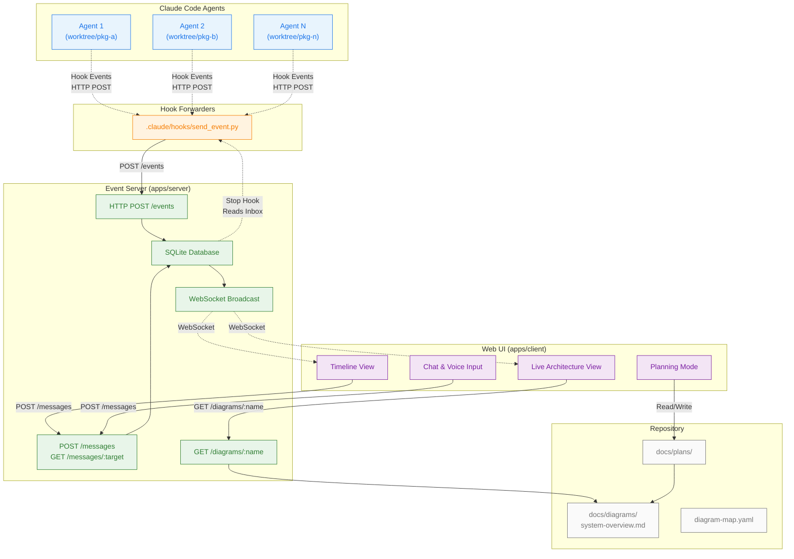

# System Overview Diagram

**Node IDs for diagram-map.yaml:**
- `hooks` - Hook forwarder script
- `server` - Event server (HTTP, WebSocket, Database)
- `database` - SQLite database
- `client` - Web UI client
- `timeline` - Timeline view panel
- `architecture` - Live architecture view panel
- `chat` - Chat & voice input panel
- `planning` - Planning mode panel