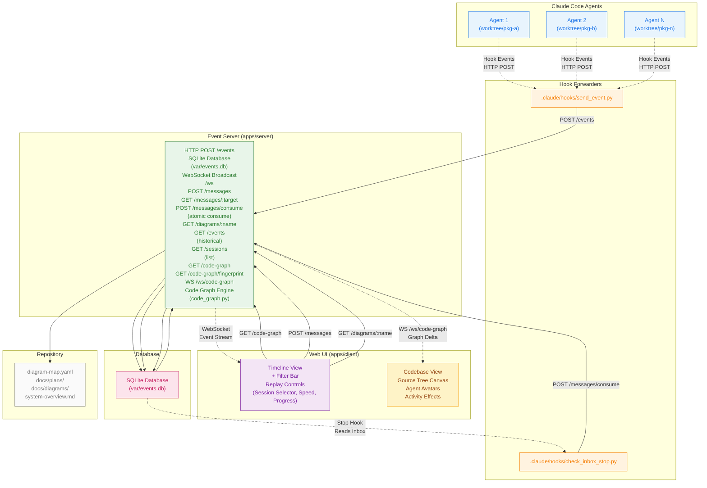

# System Overview Diagram

**Node IDs for diagram-map.yaml:**
- `hooks` - Hook forwarder script (node-hooks)
- `server` - Event server (node-server)
- `database` - SQLite database (node-database)
- `client` - Web UI client (node-client)
- `codebase` - Codebase view components (node-codebase)
- `planning` - Repository planning files (node-planning)