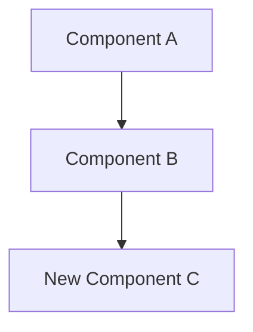
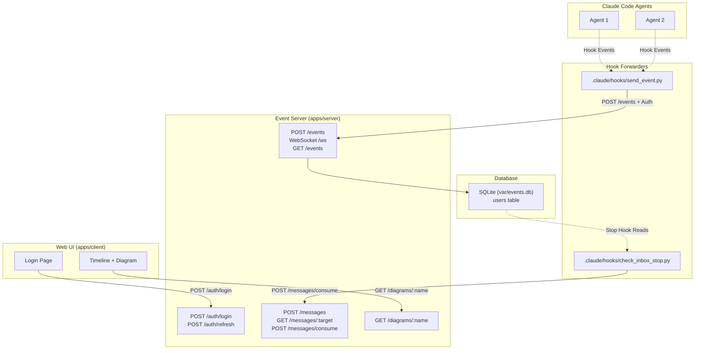

# Plan Folder Format

This document defines the format for plan folders used in the Planning mode (Phase P6).

## Overview

A plan is a proposed set of changes to the repository's living architecture diagrams. Plans are stored as folders under `docs/plans/` and consist of three files:

```
docs/plans/
├── <plan-name>/
│   ├── plan.md              # Written plan with rationale
│   ├── proposed-diagram.md  # Mermaid diagram showing the proposed architecture
│   └── tasks.md             # Task list with node ID tags
```

Plan folder names **must** use kebab-case (e.g., `add-user-auth`, `refactor-event-pipeline`).

---

## File 1: `plan.md` — Written Plan

Contains the human-readable plan description. Recommended structure:

```markdown
# Plan Title

## Overview
Brief summary of what this plan accomplishes and why.

## Assumptions
- Assumption 1
- Assumption 2

## Open Questions
- Question 1?
- Question 2?

## Details
Detailed description of the changes, including:
- Which components are affected
- What the new architecture looks like
- Any migration steps required
```

The `Assumptions` and `Open Questions` sections are used by the UI (P6.4) to present reply boxes for each item.

---

## File 2: `proposed-diagram.md` — Proposed Architecture Diagram

Contains one or more Mermaid diagrams showing the architecture **after** the plan is implemented.

```markdown
# Proposed Architecture

## System Overview (Proposed)



The diagram(s) in this file are validated by `npm run diagrams:check`. At minimum, there should be one diagram showing the complete proposed system overview. Additional diagrams (e.g., sequence diagrams, detail views) are allowed.

**Important**: Node IDs in the proposed diagram should match the node IDs in `diagram-map.yaml` so that the UI can highlight added/modified/removed nodes (P6.3).

---

## File 3: `tasks.md` — Task List with Node ID Tags

Contains a checklist of tasks required to implement the plan. Each task **must** be tagged with the node ID(s) from `diagram-map.yaml` that it touches.

```markdown
# Tasks

## Phase 1: Backend Changes

- [ ] Task 1.1: Add new endpoint (node: server)
- [ ] Task 1.2: Update database schema (node: database)

## Phase 2: Frontend Changes

- [ ] Task 2.1: Create new component (node: client)
- [ ] Task 2.2: Update hook registration (node: hooks)

## Phase 3: Documentation

- [ ] Task 3.1: Update diagrams (node: planning)
```

### Node ID Tag Format

Use the syntax `(node: <node-id>)` at the end of each task line, where `<node-id>` is one of the node IDs defined in `diagram-map.yaml`.

Valid node IDs (from current `diagram-map.yaml`):
- `server` — Event server (`apps/server/**`)
- `client` — Web UI client (`apps/client/**`)
- `hooks` — Hook forwarders (`.claude/hooks/**`)
- `database` — SQLite database (`docs/diagrams/**`)
- `planning` — Planning files (`docs/plans/**`)

A task can tag multiple nodes: `(node: server, client)`.

---

## Example Plan Folder

```
docs/plans/add-user-authentication/
├── plan.md
├── proposed-diagram.md
└── tasks.md
```

### `plan.md`
```markdown
# Add User Authentication

## Overview
Add JWT-based authentication to the event server and client.

## Assumptions
- Users authenticate via a shared token (existing mechanism)
- No OAuth integration in MVP

## Open Questions
- Should we support API keys in addition to JWT?
- Token expiration policy?

## Details
- Add `/auth/login` and `/auth/refresh` endpoints to server
- Store password hashes in database
- Add login page and token storage to client
- Update hook forwarders to include auth headers
```

### `proposed-diagram.md`
```markdown
# Proposed System Overview



---

## Validation

Run `npm run diagrams:check` to validate the `proposed-diagram.md` file. This uses the Mermaid CLI (`mmdc`) to check syntax.

The `npm run check` command includes `diagrams:check`, so all diagrams in the repo (including plan diagrams) are validated on every check.

---

## Consumers

These plan files are consumed by:
- **P6.2** (Planner agent) — writes the three plan files
- **P6.3** (Canvas renderer) — compares `proposed-diagram.md` with living diagrams to show diff
- **P6.4** (Assumptions panel) — reads `Assumptions` and `Open Questions` from `plan.md`
- **P6.6** (Approve script) — reads `tasks.md` to load tasks into dispatch queue
- **P6.7** (Promote script) — copies `proposed-diagram.md` to living diagram on completion