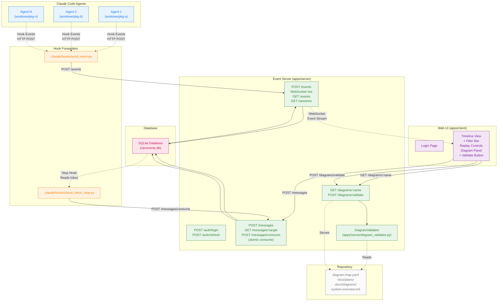

# Proposed System Overview (with Diagram Validation)

**Node IDs for diagram-map.yaml (unchanged):**
- `hooks` - Hook forwarder scripts (SendEvent, CheckInbox)
- `server` - Event server (Auth, Events, Messages, Diagrams, Validator)
- `database` - SQLite database (DB)
- `client` - Web UI client (Login, Dashboard)
- `planning` - Repository planning files (Planning)