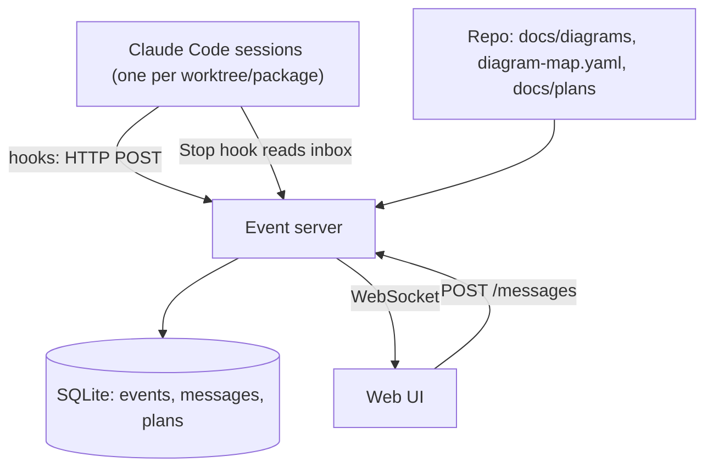

# Agent Control Center: Implementation Plan

*Written for implementing agents. Read Sections 1 and 2 completely before doing anything else.*

## 1. Ground rules

- This document is the single source of truth for what is done, what is next, and why. If the code and this document disagree, stop and record an Open Question.
- Work on **one task at a time**, in order. Do not skip ahead and do not start a task whose dependencies are not `done`.
- A task is `done` only when its **Done when** check passes and you actually ran it. Never mark a task done on a guess.
- If you are unsure about anything, do not guess. Add an entry to Section 6 (Open Questions) and stop work on that task.
- If the same failure happens three times, stop. Write the blocker in the Session Log and end the session.
- Make small commits. Commit message format: `P1.3: short description`.
- Do not change task definitions, Done-when checks, or these ground rules. If a task seems wrong, add an Open Question.
- New ideas go in Section 8 (Backlog), never into the current phase.
- Never put secrets in the repo. Bind servers to localhost only.

## 2. Session protocol

### 2.1 Starting a session (do these steps in order)

1. Read this whole document from top to bottom.
2. Run `git status` and `git log -5`. Confirm you are on the plan branch or a task branch and that there are no unexplained uncommitted changes. If there are, note them in the Session Log and ask the user before continuing.
3. Open Section 3 (Status dashboard) and Section 7 (Tasks). Find the **first** task whose status is `in-progress` or `todo` and whose dependencies are all `done`. That is your task for this session.
4. Append a new entry to Section 9 (Session Log) using the template in 2.5. Fill in: session number, agent name, date, goal (task IDs), and starting state.
5. In Section 7, change your task’s status from `todo` to `in-progress` and write the session number in the Owner column.
6. In the Session Log entry, restate the task’s Done-when check in one line, in your own words.
7. Run the existing checks (tests, typecheck, lint) and record the baseline result in the log. If checks already fail, record that and do not try to fix unrelated failures.

### 2.2 During the session

- Do only the task you claimed. Commit after each meaningful step.
- If you find extra work, add one line to Section 8 (Backlog).
- If you must make a design choice not already covered, add an entry to Section 5 (Decisions) with your reasoning, then continue with it.
- If you need information you do not have, add an Open Question and stop.

### 2.3 Ending a session (always do this, even if you are interrupted or blocked)

1. Run all checks: tests, typecheck, lint, and the diagram check once task P3.4 is done.
2. Update the task’s status in Section 7:
   - `done` only if the Done-when check passes and you ran it.
   - Otherwise leave it `in-progress` and write exactly what remains in the Notes line under the task table.
   - Use `blocked` if you cannot continue, and link the Open Question.
3. Update the counts in Section 3 (Status dashboard).
4. If you changed structure (new module, service, endpoint, queue, or dependency), update the matching living diagram under `docs/diagrams/` and record it in the log.
5. Complete your Session Log entry: end time, files changed, commands run and their results, what is not done, next task ID, blockers.
6. Commit with message `docs: session N log`.
7. Give the user a summary of at most five lines: what you finished, what is next, and anything they must decide.

### 2.4 Which parts of this document you may edit

| Section | Allowed edit |
| --- | --- |
| 1. Ground rules | Never |
| 2. Session protocol | Never |
| 3. Status dashboard | Update counts and phase status |
| 4. Project summary | Only when a Decision changes it; note the Decision ID |
| 5. Decisions | Append only |
| 6. Open Questions | Append; or mark answered by adding the answer, source, and date |
| 7. Tasks | Change Status, Owner, and Notes only |
| 8. Backlog | Append only |
| 9. Session Log | Append only; edit only your own entry |

### 2.5 Templates

**Session Log entry**

```
### Session N: YYYY-MM-DD (agent name)
- Goal: P#.# (task title)
- Done-when, in my words: ...
- Starting state: branch, baseline check results
- What changed: files and a one-line reason each
- Verified: exact commands run and their results
- Diagrams changed: file names, or None needed
- Not done: ...
- Next task: P#.#
- Blockers / questions: Q# or None
```

**Decision entry**

```
- D#: Title (date, session N). Decision: ... Reason: ... Alternatives rejected: ...
```

**Open Question entry**

```
- Q#: Question (session N). Why it matters: ... Status: open | answered. Answer, source, date: ...
```

## 3. Status dashboard

Statuses: `todo`, `in-progress`, `done`, `blocked`.

| Phase | Name | Done / Total | Status |
| --- | --- | --- | --- |
| P0 | Foundations | 4 / 4 | done |
| P1 | Event pipeline | 0 / 5 | todo |
| P2 | Timeline UI | 0 / 3 | todo |
| P3 | Diagram mapping | 0 / 4 | todo |
| P4 | Live architecture view | 0 / 4 | todo |
| P5 | Chat and voice input | 0 / 6 | todo |
| P6 | Planning mode | 0 / 8 | todo |
| P7 | Execution orchestration | 0 / 4 | todo |
| P8 | Hardening | 0 / 4 | todo |

## 4. Project summary

**Goal.** A local web app that lets one person watch and steer a team of Claude Code agents working in a monorepo. It shows what each agent is doing in real time, renders the repository’s architecture diagrams with live highlights on whatever is being changed, lets the person talk to agents by text or voice, and has a planning mode where proposed changes are drafted as a visual diff against the current architecture before any code is written.

**Core idea.** The repository’s *living diagrams* (Mermaid files kept in sync with the code) are the source of truth. A plan is a proposed diff against those diagrams. There are three layers on one canvas:

| Layer | Source | Look |
| --- | --- | --- |
| Current | Living diagrams in the repo | Solid, neutral |
| Proposed | Draft files in `docs/plans/<name>/` | Added = green, modified = amber, removed = red |
| Active | Hook events from running agents | Agent badge and pulse on the node being edited |

Planning shows Current plus Proposed. Execution shows Current plus Active, and Proposed items turn solid as tasks complete.

**Data flow.**



**Default stack** (confirm in P1.1): Bun server with SQLite, Vue client (as in the open-source project disler/claude-code-hooks-multi-agent-observability, which we start from), Mermaid for rendering, Python hook scripts run with `uv`.

## 5. Decisions

- D1: Diagrams are Mermaid in `.md` files, edited through chat for the MVP. A structured nodes-and-edges model is deferred (Backlog B1). Reason: simplest thing that works and agents read it natively.
- D2: Start from disler’s observability tool rather than writing a pipeline from scratch (to be confirmed or reversed in P1.1).
- D3: Hooks make **no LLM calls**. The user has no Anthropic API key and routes models through a proxy. Do not use the `--summarize` option of the forwarder.
- D4: Plans are files in the repo on plan branches, so agents can read them and git versions them.
- D5: The server listens on localhost only and requires a token.

## 6. Open Questions

These must be answered from current official documentation or by a small experiment. Record the answer and its source. Do not rely on memory, because these tools change quickly.

- Q1: Which hook events exist in current Claude Code, and what fields does each payload contain (session id, tool name, file path)? Status: answered. Answer: There are 28+ hook events across 5 categories: Per Session (SessionStart, SessionEnd), Per Turn (UserPromptSubmit, UserPromptExpansion, Stop, StopFailure), Per Tool Call (PreToolUse, PermissionRequest, PermissionDenied, PostToolUse, PostToolUseFailure, PostToolBatch), Async/Standalone (Notification, MessageDisplay, SubagentStart, SubagentStop, TaskCreated, TaskCompleted, TeammateIdle, InstructionsLoaded, ConfigChange, CwdChanged, DirectoryAdded, FileChanged, WorktreeCreate, WorktreeRemove, PreCompact, PostCompact, PreModelSwitch, PostModelSwitch, Elicitation, ElicitationResult, Setup). All events include common fields: session_id, prompt_id, transcript_path, cwd, scratchpad_dir, permission_mode, hook_event_name, agent_id, agent_type. Tool events include tool_name, tool_input, tool_use_id. Stop includes last_assistant_message. Source: https://code.claude.com/docs/en/hooks (2026-10-24).
- Q2: Can a Stop hook block stopping and inject a user message as the reason to continue? What exact output format does it need? Status: answered. Answer: Yes, a Stop hook can block with `decision: "block"` and reason, or inject context to continue with `hookSpecificOutput.hookEventName: "Stop"` and `additionalContext: "..."`. It can also stop entirely with `continue: false` and `stopReason: "..."`. Source: https://code.claude.com/docs/en/hooks (2026-10-24).
- Q3: Does Claude Code’s plan mode emit anything a hook can observe when a plan is approved? Status: answered. Answer: Based on official docs, plan mode is not explicitly listed as a hook event. The closest events are UserPromptSubmit (before processing), PermissionRequest (for tool approval), and Notification (permission_prompt). Plan approval likely goes through the permission system and would fire PermissionRequest/Notification events, but no dedicated "plan_approved" hook event exists. Source: https://code.claude.com/docs/en/hooks, https://code.claude.com/docs/llms.txt (2026-10-24).
- Q4: Do hooks fire normally when Claude Code is launched through the user’s LLM proxy launcher? Status: answered. Answer: Yes, hooks fire normally in headless mode (`claude -p`) and Agent SDK when `settingSources` includes "project" (default). The CLI reads `.claude/settings.json` and runs hooks even in non-interactive mode. Bare mode (`--bare`) skips hook loading. Source: https://code.claude.com/docs/en/headless.md (2026-10-24).
- Q5: Is streaming input available through headless mode or the Agent SDK, and does it work with the user’s proxy? Status: answered. Answer: Yes, streaming input mode is available via Agent SDK (Python’s `ClaudeSDKClient` or TypeScript’s `query` with async generator). It works with any authentication method including API keys. For proxy usage, set `ANTHROPIC_API_KEY` with a key from Claude Console or use `apiKeyHelper` in settings. The proxy works as long as the API endpoint is accessible. Source: https://code.claude.com/docs/en/agent-sdk/streaming-vs-single-mode.md, https://code.claude.com/docs/en/agent-sdk/claude-code-features.md (2026-10-24).

## 7. Tasks

For every task: do the **What** described, then run the **Done when** check. Dependencies are task IDs that must be `done` first.

### Phase P0: Foundations

| ID | What | Depends on | Done when | Status | Owner |
| --- | --- | --- | --- | --- | --- |
| P0.1 | Create the repo layout: `apps/server`, `apps/client`, `.claude/hooks`, `docs/diagrams`, `docs/plans`. Add a root `README.md` stating the project goal in three sentences and a root `package.json` with a `check` script. | none | The directories exist and `npm run check` runs and exits 0. | done | Session 1 |
| P0.2 | Create the root `CLAUDE.md`. Include these ground rules, the session protocol pointer to this document, and a Living Diagrams section (diagram index table, when to update, smallest-edit rule, Mermaid conventions, final-summary line listing diagrams changed). | P0.1 | `CLAUDE.md` exists and contains a diagram index table and the line telling agents to state `No diagram changes needed` when applicable. | done | Session 1 |
| P0.3 | Answer Q1 to Q5 by reading current official docs or running small experiments. Record each answer, its source, and the date in Section 6. | P0.1 | All five questions are marked answered with a source. If any cannot be answered, mark it blocked and tell the user. | done | Session 1 |
| P0.4 | Create `docs/diagrams/system-overview.md` showing this project’s own components (hooks, server, database, client) and a first `diagram-map.yaml` at the repo root mapping `apps/server/**`, `apps/client/**`, `.claude/hooks/**` to node IDs in that diagram. | P0.2 | The Mermaid renders without error and every top-level source directory matches a mapping entry. | done | Session 1 |

Notes:

### Phase P1: Event pipeline

| ID | What | Depends on | Done when | Status | Owner |
| --- | --- | --- | --- | --- | --- |
| P1.1 | Clone or vendor the disler observability project into `apps/`. Remove anything that calls an LLM. Confirm or reverse D2 in Section 5. | P0.3 | The server starts, and a hand-written `curl` POST of a test event appears in the database. | todo |  |
| P1.2 | Write the hook forwarder script (`.claude/hooks/send_event.py`). It reads the hook payload, adds the source app (package name), and POSTs it to the server. No LLM calls. Register it in `.claude/settings.json` for the events listed in Q1’s answer, at minimum tool-use, stop, and subagent-stop events. | P1.1 | Running a real Claude Code session in this repo creates rows in the database for each registered event type. | todo |  |
| P1.3 | Tag every event with `session_id`, `source_app`, and `agent_name`. | P1.2 | A query by session id returns only that session’s events, and events from two simultaneous sessions are distinguishable. | todo |  |
| P1.4 | Broadcast new events over WebSocket. | P1.3 | Two browser tabs open on the dashboard both show a new event within one second of it being posted. | todo |  |
| P1.5 | Add a shared-token check and bind the server to `127.0.0.1`. | P1.4 | A request without the token returns 401, and the server is unreachable from another machine. | todo |  |

Notes:

### Phase P2: Timeline UI

| ID | What | Depends on | Done when | Status | Owner |
| --- | --- | --- | --- | --- | --- |
| P2.1 | Show a live timeline with one lane per session or agent. | P1.4 | Events from two sessions appear in separate lanes, in time order, as they arrive. | todo |  |
| P2.2 | Add filters by package, agent, and event type. | P2.1 | Selecting a filter hides non-matching events immediately. | todo |  |
| P2.3 | Add replay of a past session from the database. | P2.1 | Choosing an old session plays its events back in order at selectable speed. | todo |  |

Notes:

### Phase P3: Diagram mapping

| ID | What | Depends on | Done when | Status | Owner |
| --- | --- | --- | --- | --- | --- |
| P3.1 | Define the schema of `diagram-map.yaml`: a list of entries with `glob`, `diagram` (file), and `node` (ID). Document it in `docs/diagrams/README.md`. | P0.4 | The README documents the schema with one example, and the current file validates against it. | todo |  |
| P3.2 | Write a function mapping a file path to zero or more nodes. The most specific glob wins. Add unit tests, including a path with no match. | P3.1 | The unit tests pass, covering exact, nested, overlapping, and unmatched paths. | todo |  |
| P3.3 | Emit an `unmapped_edit` event when a file edit matches no entry, and a `diagram_drift` warning when files under a mapped path change with no change to the matching diagram. | P3.2, P1.4 | Editing an unmapped file produces the event, and the dashboard lists it. | todo |  |
| P3.4 | Write `npm run diagrams:check`, which validates the syntax of every Mermaid file under `docs/` using the Mermaid CLI. Add it to `npm run check`. | P0.4 | A file with a deliberate syntax error makes the command fail, and fixing it makes it pass. | todo |  |

Notes:

### Phase P4: Live architecture view

| ID | What | Depends on | Done when | Status | Owner |
| --- | --- | --- | --- | --- | --- |
| P4.1 | Add a server endpoint that returns a diagram file by name, and a client panel that renders it with Mermaid. | P3.4, P1.4 | The panel shows `system-overview` and shows an error message, not a blank page, if the diagram is invalid. | todo |  |
| P4.2 | On each file-edit event, map the path to a node and highlight that node with the agent’s colour and name. Fade after 10 seconds. | P4.1, P3.2 | Editing a mapped file in a live session lights the matching node within two seconds. | todo |  |
| P4.3 | When a diagram file itself changes, re-render and mark added or changed nodes using `git diff` against the previous version. | P4.1 | Adding a node to a diagram in a test session makes it appear highlighted as new. | todo |  |
| P4.4 | Show an indicator listing unmapped edits. | P4.2, P3.3 | An edit to an unmapped file adds an entry to the list. | todo |  |

Notes:

### Phase P5: Chat and voice input

| ID | What | Depends on | Done when | Status | Owner |
| --- | --- | --- | --- | --- | --- |
| P5.1 | Add an `inbox` table and `POST /messages` with fields `target` (agent, package, or `lead`) and `text`. | P1.5 | Posting a message stores it and a read endpoint returns it for that target. | todo |  |
| P5.2 | Add a chat box to the UI with a target selector and a message history. | P5.1 | Sending from the UI creates a stored message and shows it in history. | todo |  |
| P5.3 | Write a stop-time hook that checks the inbox for the session’s agent and, if a message is waiting, returns it so the agent continues with it. Use the exact format found in Q2. Mark the message delivered. | P5.1, P0.3 | With a running agent that tries to stop, a waiting message is delivered once and the agent acts on it. | todo |  |
| P5.4 | Add a way for an agent to ask the user a question (`POST /questions`) and for the UI to show it and send back an answer. | P5.2 | A question posted by a script appears in the UI, and the answer is retrievable by the asker. | todo |  |
| P5.5 | Add a microphone button using the browser’s built-in speech recognition that fills the chat box. | P5.2 | Speaking a sentence puts its text in the box, which the user can edit before sending. | todo |  |
| P5.6 | Route messages with no target to the lead agent, and support `@name` addressing. | P5.2 | An unaddressed message reaches the lead inbox, and `@billing hello` reaches only the billing inbox. | todo |  |

Notes:

### Phase P6: Planning mode

| ID | What | Depends on | Done when | Status | Owner |
| --- | --- | --- | --- | --- | --- |
| P6.1 | Define the plan folder format: `docs/plans/<name>/plan.md` (written plan), `proposed-diagram.md` (the Mermaid after the change), `tasks.md` (task list, each task tagged with node IDs it touches). Document it in `docs/plans/README.md`. | P4.1 | The README documents the format, and one hand-written sample plan passes `npm run diagrams:check`. | todo |  |
| P6.2 | Create a read-only planner agent definition at `.claude/agents/planner.md`. It reads the repo and diagrams, asks only necessary questions, and writes only the three plan files. | P6.1 | Running it on a sample request produces all three files and changes no other file. | todo |  |
| P6.3 | Render Current versus Proposed on one canvas by comparing the two diagrams: added nodes green, modified amber, removed red. | P6.1, P4.3 | The sample plan shows at least one node in each of the three states. | todo |  |
| P6.4 | Add a panel listing the plan’s assumptions and open questions, taken from a labelled section of `plan.md`, with a reply box for each. | P6.2 | Replying to an assumption sends the reply to the planner and the panel updates after the planner revises the plan. | todo |  |
| P6.5 | Support two or three alternative variants of a plan, shown side by side with a trade-offs table. | P6.3 | Choosing a variant records a Decision entry in the plan folder and hides the others. | todo |  |
| P6.6 | Add an Approve button. It commits the plan on a plan branch, emits a `plan_approved` event, and loads `tasks.md` into the dispatch queue. | P6.2, P5.1 | Clicking Approve creates the commit and event, and the queue shows the tasks with their node tags. | todo |  |
| P6.7 | Write a promote script that, after a plan’s tasks are done, copies the proposed diagram into the real living diagram and removes planned styling. | P6.6 | Running it on the sample plan updates the real diagram, and the check script passes. | todo |  |
| P6.8 | Support starting a brand-new project: start from an empty canvas and build `system-overview` top-down through conversation, and have the first approved plan scaffold the repo including `CLAUDE.md` and the diagram index. | P6.6 | Starting from an empty folder produces a repo with the diagram rules and a first diagram. | todo |  |

Notes:

### Phase P7: Execution orchestration

| ID | What | Depends on | Done when | Status | Owner |
| --- | --- | --- | --- | --- | --- |
| P7.1 | Run a small experiment comparing two dispatch styles: interactive sessions steered through hooks, versus headless runs controlled by the server. Use the answers to Q4 and Q5. Record the choice as a Decision. | P5.3, P0.3 | A Decision entry exists with results of both experiments. | todo |  |
| P7.2 | Build the task queue and dispatcher. Each task runs in its own git worktree and is tagged with its package. | P7.1, P6.6 | Two approved tasks run in parallel in separate worktrees and each emits events with the right tags. | todo |  |
| P7.3 | Prevent parallel tasks from touching the same diagram node or shared file. | P7.2 | Two tasks that share a node are run one after the other, not at the same time. | todo |  |
| P7.4 | When a task finishes, turn its Proposed nodes solid on the canvas. | P7.2, P6.3 | Completing a task changes its nodes from planned styling to solid. | todo |  |

Notes:

### Phase P8: Hardening

| ID | What | Depends on | Done when | Status | Owner |
| --- | --- | --- | --- | --- | --- |
| P8.1 | Handle malformed or oversized events without crashing the server. | P1.5 | Posting garbage returns a 4xx error and the server stays up. | todo |  |
| P8.2 | Add retention: prune events older than a configurable number of days. | P1.3 | A test with old rows shows them removed and recent rows kept. | todo |  |
| P8.3 | Write `docs/RUNBOOK.md`: how to install, start, add a package, add hooks to a new repo, and troubleshoot. | P7.4 | A new person can follow it from a clean checkout to a working dashboard. | todo |  |
| P8.4 | Show rate-limit and model errors from agents clearly in the timeline, since free-tier models may fail or throttle. | P2.1 | A simulated rate-limit event appears highlighted in the timeline. | todo |  |

Notes:

## 8. Backlog

Append one line per idea. Do not work on these until the user promotes them.

- B1: Structured JSON or YAML diagram model with drag-and-drop editing, rendering to Mermaid.
- B2: Plan critique by a second agent before approval.
- B3: Export decisions as ADR files.

## 9. Session Log

### Session 1: 2026-10-24 (Claude)
- Goal: P0.1 (Create the repo layout)
- Done-when, in my words: The required directories exist and running `npm run check` exits with code 0.
- Starting state: Clean repository with CLAUDE.md and docs/plans/zod-control-center.md.
- What changed:
  - `apps/server`, `apps/client`, `.claude/hooks`, `docs/diagrams`, `docs/plans` created
  - `README.md` created with 3-sentence project overview
  - `package.json` created with check script
- Verified: Ran `npm run check`, output: `Check passed` (exit 0).
- Diagrams changed: None needed
- Not done: P0.2, P0.3, P0.4
- Next task: P0.2
- Blockers / questions: None

### Session 2: 2026-10-24 (Claude)
- Goal: P0.2 (Create root CLAUDE.md), P0.3 (Answer Q1-Q5), P0.4 (Create system-overview.md and diagram-map.yaml)
- Done-when, in my words: CLAUDE.md contains diagram index table and "No diagram changes needed" line; all five questions answered with sources; Mermaid renders without error and all top-level source directories have mapping entries.
- Starting state: P0.1 done, directories and package.json exist.
- What changed:
  - `CLAUDE.md` replaced with full ground rules, session protocol pointer, and Living Diagrams section
  - `docs/plans/zod-control-center.md` Section 6 updated with answers to Q1-Q5 with sources and dates
  - `docs/diagrams/system-overview.md` created with Mermaid flowchart of system components
  - `diagram-map.yaml` created mapping apps/server/**, apps/client/**, .claude/hooks/**, docs/diagrams/**, docs/plans/** to node IDs
- Verified: Mermaid CLI renders system-overview.md without error (`mmdc` output: `✅ ./test-diagram-1.png`); all 5 top-level directories (apps/server, apps/client, .claude/hooks, docs/diagrams, docs/plans) have mapping entries in diagram-map.yaml.
- Diagrams changed: docs/diagrams/system-overview.md
- Not done: None in P0
- Next task: P1.1 (Clone or vendor disler observability project)
- Blockers / questions: None

